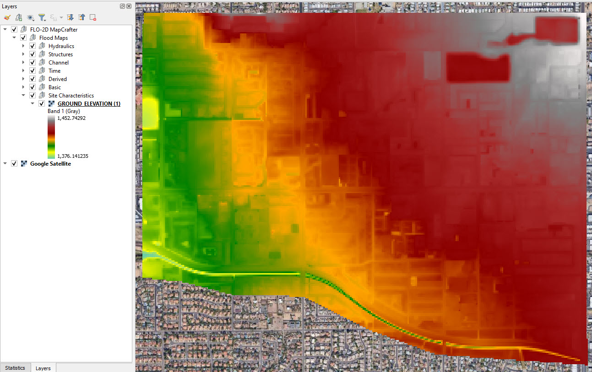

.. _mapcrafter:

FLO-2D MapCrafter
==================

FLO-2D MapCrafter is a QGIS plugin designed to transform FLO-2D output
files into comprehensive visualizations. It generates flood maps for
single-phase simulations, sediment maps, mudflow maps, and two-phase
simulation flood maps. Additionally, MapCrafter goes beyond by creating
hazard maps, highlighting areas with elevated risks based on FLO-2D
simulations, aiding in risk management. The plugin also streamlines the
QGIS layout manager process by automatically generating templates for
easy customization.

.. toctree::
   :maxdepth: 2
   :caption: Contents:

   1flood-maps.rst
   2sediment-maps.rst
   3mudflow-maps.rst
   4two-phase-maps.rst
   5velocity-vector-maps.rst
   6hazard-maps.rst
   7storm-drain-plots.rst
   8layouts.rst

