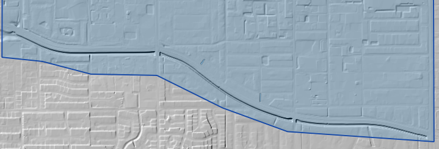

.. _cross_sections_editor:

Cross Sections Editor
======================

This section provides a comprehensive reference to the tools and features available in the 
**Cross Section Editor** for developing and modifying FLO-2D channels.

Rather than presenting a step-by-step workflow, it describes the individual tools, their functions, 
and how to use them. Users can navigate directly to specific topics as needed.

.. contents:: Quick Navigation
   :depth: 2
   :local:

.. image:: ../../img/Widgets/crosssections.png

For a channel tutorial series, please see the Gila Self-Help Tutorials.

   :ref:`Channel Tutorial <channel-tutorial>`

Digitize Channels
--------------------

Elevation
______________

The elevation raster symbology can be edited so that the channel is well defined.

1. Right click on the Elevation Raster and click on properties.

.. image:: ../../img/User-Cross-Sections-Widget/User001.png

2. Select the Symbology tab and set the Render Type to Hillshade.

3. Set the Z scale to 2.

.. image:: ../../img/User-Cross-Sections-Widget/User002.png

Digitize Left and Right Banks
-------------------------------

#. Select the
   Left Bank Line layer.

#. Click on both the start  
   editing button and the add feature button.

#. Create a polyline to  
   represent the left bank looking downstream and click to save the layer.

#. It is important to  
   create the segments from order upstream to downstream.

.. image:: ../../img/User-Cross-Sections-Widget/User004.png

.. image:: ../../img/User-Cross-Sections-Widget/User006.png

#. Repeat the process for  
   the all the various channel segments and save.

.. image:: ../../img/User-Cross-Sections-Widget/User007.png

Digitize Cross Sections
-------------------------

To create natural cross sections, the cross sections should be numbered consecutively from upstream to downstream for
each channel segment.

.. note:: - Draw polylines from left bank to right bank looking downstream.
          - The first cross section must cross the left and right bank and be inside the same grid elements as the end
            points.
          - Each cross sections must cross the left and right bank.

1. Click the Add Cross
   sections lines button.

2. Digitize the cross  
   section on the map.

3. Name the cross section and  
   click OK to finish the feature.

4. Click save to complete  
   the process and load the data into the widget.

5. Repeat this process from upstream to down stream.

.. image:: ../../img/User-Cross-Sections-Widget/User008.png
  

.. image:: ../../img/User-Cross-Sections-Widget/User009.png

The cross sections shown in the following image have been digitized.

The finished product will look something like the following image.

.. image:: ../../img/User-Cross-Sections-Widget/User010.png

Natural Cross Section - Station Elevation
_________________________________________________

The preferred and easiest way to sample elevation data for a cross section is by using the FLO-2D Sample Elevation tool.
Once the cross sections are digitized onto the map, the Sample Elevation tools are used to sample elevation data from a
raster into Stations/Elevation
data sets for all or individual cross sections.

This section will focus on natural channel geometry (N type).

1. Set the elevation raster as  
   the Source Raster Layer and use either button to sample one or all cross sections.

.. image:: ../../img/User-Cross-Sections-Widget/User011.png

2. The station elevation data is  
   limited to the point where the left and right bank intersect the cross section.

3. If too much or too little data  
   has been sampled, adjust the left or right bank alignment and sample the elevation again.

.. image:: ../../img/User-Cross-Sections-Widget/User012.png

Rectangular Cross Sections
____________________________

#. Set up the Editor Widget.
   Type = Rectangular base n = 0.020

.. image:: ../../img/User-Cross-Sections-Widget/User027.png

#. Click the create  
   cross section button.

.. image:: ../../img/User-Cross-Sections-Widget/User028.png
   
#. Create the first cross section by clicking the left bank point,
   followed by the right bank point. Right-click to finish the line
   and press Enter to skip the attribute entry.
   The attributes will be assigned later.

.. image:: ../../img/User-Cross-Sections-Widget/User029.png
  
#. Click Save to load  
   the cross section into the Table Editor.

.. image:: ../../img/User-Cross-Sections-Widget/User030.png

#. Fill the bank elevation data with the sample elevation tool.

   For more detailed instructions
   See :ref:`Sample bank data <sample-bank-data>`.

.. image:: ../../img/User-Cross-Sections-Widget/user064.png

#. Use the table editor to fill the width and depth variables for each cross section.  It is also possible to use the
   Attribute table editor for the Advanced Layers.

.. image:: ../../img/User-Cross-Sections-Widget/user063.png
  
.. note:: A quick way to modify channel width and depth values is to edit them directly in the Advanced Layers attribute table.

          .. image:: ../../img/User-Cross-Sections-Widget/user062.png

Trapezoidal Cross Sections
______________________________

#. Set up the Editor Widget.
   Type = Trapezoidal base n = 0.020

.. image:: ../../img/User-Cross-Sections-Widget/user065.png
  

#. Click the create  
   cross section button.

.. image:: ../../img/User-Cross-Sections-Widget/User028.png
 

#. Create the first cross section by clicking the left bank point,
   followed by the right bank point. Right-click to finish the line
   and press Enter to skip the attribute entry.
   The attributes will be assigned later.

.. image:: ../../img/User-Cross-Sections-Widget/user066.png
  

#. Click Save to load the  
   cross section into the Table Editor.

.. image:: ../../img/User-Cross-Sections-Widget/User030.png

#. Fill the bank elevation data with the sample elevation tool.

   For more detailed instructions
   See :ref:`Sample Bank Data <sample-bank-data>`.

.. image:: ../../img/User-Cross-Sections-Widget/user064.png

  
#. Fill the remaining width, depth, and side slope with the table editor.

   It is also possible to use the attribute editor and the Advanced layers.

.. image:: ../../img/User-Cross-Sections-Widget/user068.png

.. note:: A quick way to modify the width, depth, and side slope variables is to use the Advanced Layers Attribute table.

          .. image:: ../../img/User-Cross-Sections-Widget/user067.png
   

Schematize 
-------------------

Natural Cross Sections
____________________________

#. Once the banks and cross sections are complete, the next step is to Schematize the channels.
   Click the Schematize button.

.. image:: ../../img/User-Cross-Sections-Widget/User013.png

#. Errors and warning will appear if  
   something is not configured correctly.

   See the :ref:`Troubleshooting <channel-troubleshooting>` if a schematize error pops up.

#. If the channel  
   schematize process was successful, the log message panel will report the schematize information.

.. image:: ../../img/User-Cross-Sections-Widget/User018.png

#. The schematized layers now have complete left bank, right bank, and cross section data.

.. note:: It is a good time to realign the left and right banks if they do not have good alignment.

.. image:: ../../img/User-Cross-Sections-Widget/User019.png

Schematize Prismatic
___________________________________________________________

1. Once the banks and cross sections are complete, the next step is to Schematize the channels.
   Click the Schematize button.

.. image:: ../../img/User-Cross-Sections-Widget/User013.png

2. Errors and warning will appear if
   something is not configured correctly.

.. image:: ../../img/User-Cross-Sections-Widget/User014.png

3. At the beginning of each segment,
   the left bank node, right bank node must be in the same cell as the end nodes on the cross sections.

.. image:: ../../img/User-Cross-Sections-Widget/User015.png

4. If the cross section does
   not touch the left or right bank, the following message will appear.

.. image:: ../../img/User-Cross-Sections-Widget/User016.png

5. Correct this condition by
   making sure each cross section crosses both banks.

.. image:: ../../img/User-Cross-Sections-Widget/User017.png

6. If the channel
   schematize process was successful, the log message panel will report the schematize information.

.. image:: ../../img/User-Cross-Sections-Widget/User018.png

7. The schematized layers now have complete left bank, right bank, and cross section data.

.. note:: It is a good time to realign the left and right banks if they do not have good alignment.

.. image:: ../../img/User-Cross-Sections-Widget/User019.png

Interpolate
--------------

Natural Cross sections
________________________

1. Inspect the cross section n-value field to ensure all n-values are present.
   If missing, fill the required n-value to the field.

2. Right click on the Cross Sections layer to open the Attribute Table.

.. image:: ../../img/User-Cross-Sections-Widget/User058.png

3. Click the interpolate button to run the interpolator.

.. image:: ../../img/User-Cross-Sections-Widget/User013.png

4. If the interpolation is performed correctly, the following message will appear.

.. image:: ../../img/User-Cross-Sections-Widget/User026.png

Prismatic Cross sections
______________________________

1. Click the interpolate button to run the interpolator.

.. image:: ../../img/User-Cross-Sections-Widget/User013.png

2. If the interpolation is performed correctly, the following message will appear.

.. image:: ../../img/User-Cross-Sections-Widget/User026.png

3. An interpolated prismatic channel looks like this.

.. image:: ../../img/User-Cross-Sections-Widget/User046.png

.. _sample-bank-data:

Sample Bank Elevations
-----------------------

Bank elevations are used to define the channel geometry and establish
the reference elevations for the channel bed. For rectangular (R) and
trapezoidal (T) cross sections, the Sample Elevation tool can assign
bank elevations using either an elevation raster or the computational grid.

Two sampling methods are available:

- **From Raster:** Samples bank elevations from an elevation raster.
  This is the preferred method when suitable elevation data are available.

- **From Grid:** Uses computational grid elevations to assign bank
  elevations. This method is an alternative when suitable raster data
  are unavailable.

Sample Elevations from Raster
_____________________________

This is the preferred method for defining channel bank elevations
when a suitable elevation raster is available.

#. Select the **From Raster** radio button in the Sample Elevation tool.

#. Select an individual cross section or all cross sections to sample.

.. image:: ../../img/User-Cross-Sections-Widget/User042.png

.. image:: ../../img/User-Cross-Sections-Widget/User043.png

Sample Elevations from Grid
___________________________

This method uses computational grid elevations to define the channel
bank elevations. It should only be used when a suitable elevation
raster is unavailable.

#. Select the **From Grid** radio button in the Sample Elevation tool.

#. Select an individual cross section or all cross sections to sample.

.. image:: ../../img/User-Cross-Sections-Widget/User038.png

.. note::

   Grid elevations may not accurately represent the channel banks.
   Because grid elevations can represent an average of the surrounding
   terrain, they may differ from the actual bank elevations and produce
   an incorrect channel bed profile.

Review the Channel Profile
__________________________

After sampling bank elevations, use the Channel Profile tool to
inspect the resulting channel profile.

#. Click the **Channel Profile** tool.

.. image:: ../../img/Buttons/run005.png

#. Select the left bank to display the channel profile.

.. image:: ../../img/User-Cross-Sections-Widget/User040.png

The following example illustrates how grid-based bank elevations
can affect the channel profile.

.. image:: ../../img/User-Cross-Sections-Widget/User041.png

If the sampled elevations do not adequately represent the channel
banks, review the elevation source and resample the bank elevations
as necessary.

Channel n-Value Interpolator
------------------------------

1. The channel n-value interpolator
   tool is used to define the n-value of a channel cross section based on the cross section geometry.

.. image:: ../../img/User-Cross-Sections-Widget/User013.png

2. The button loads the interpolator.

3. The tool assigns an n-value for the chan.dat file based on the picture below.

4. The user can choose the n-values for a minimum or maximum cross section area.

.. image:: ../../img/User-Cross-Sections-Widget/User049.png

.. image:: ../../img/User-Cross-Sections-Widget/User050.png

5. If the interpolator works, a message is displayed in the message bar.

.. image:: ../../img/User-Cross-Sections-Widget/User051.png

Channel Confluence Editor
------------------------------

1. Set up confluences using the Confluence editor.

.. image:: ../../img/User-Cross-Sections-Widget/user070.png

2. Make sure a tributary or split left bank element is adjacent to a left or right bank element of a main channel.

.. image:: ../../img/User-Cross-Sections-Widget/user071.png

3. The confluence finder will find a list of adjacent elements that can be used for the confluence.  Pick the one
   most likely to allow flow to exchange between the two channels.

.. image:: ../../img/User-Cross-Sections-Widget/user069.png

.. _channel-troubleshooting:

Channel Editor Troubleshooting
------------------------------

This section describes common errors and warnings associated with
channel schematization, interpolation, cross-section geometry, and
channel data. Each error has a CH-XXX identifier, a description of
the problem, and corrective steps.

Channel Schematization
______________________

.. _ch-001:

CH-001: Cross Section Does Not Intersect Both Banks
+++++++++++++++++++++++++++++++++++++++++++++++++++

**Problem:** A cross section does not intersect both the left
and right channel banks.

**Solution:**

1. Locate the affected cross section.
2. Verify that the cross section intersects both channel banks.
3. Extend or reposition the cross section as necessary.
4. Save the edits and run Schematize again.

.. image:: ../../img/User-Cross-Sections-Widget/user100.png

.. _ch-002:

CH-002: Left Bank Intersects a Cross Section More Than Once
+++++++++++++++++++++++++++++++++++++++++++++++++++++++++++

**Problem:** A left bank segment touches or intersects the same
cross-section line at more than one location.

**Solution:**

1. Locate the affected left bank segment and cross section.
2. Inspect the bank alignment for loops, sharp bends, or
   overlapping geometry.
3. Adjust the left bank so that it intersects the cross
   section only once.
4. Verify that the cross section still intersects both banks.
5. Save the edits and run Schematize again.

.. image:: ../../img/User-Cross-Sections-Widget/user101.png

.. _ch-003:

CH-003: Incorrect Starting Cross-Section Alignment
++++++++++++++++++++++++++++++++++++++++++++++++++

**Problem:** The starting bank nodes and cross-section endpoints
are not located within the corresponding grid elements.

**Solution:**

1. Locate the first cross section of the channel segment.
2. Verify that the left bank node and corresponding
   cross-section endpoint are in the same grid element.
3. Repeat this check for the right bank node and endpoint.
4. Adjust the bank or cross-section alignment as necessary.
5. Save the edits and run Schematize again.

.. image:: ../../img/User-Cross-Sections-Widget/user102.png

.. _ch-006:

CH-006: Schematized Channel Segments Layer Is Empty
+++++++++++++++++++++++++++++++++++++++++++++++++++

**Problem:** The Schematized Channel Editor cannot find any
schematized channel segments.

**Solution:**

1. Verify that the left and right channel banks have
   been digitized.
2. Verify that the channel cross sections have been created.
3. Run the Schematize tool to generate the channel data.
4. Confirm that the Schematized Channel Segments layer
   contains channel features.
5. Reopen the Schematized Channel Editor.

.. image:: ../../img/User-Cross-Sections-Widget/user106.png

.. _ch-007:

CH-007: Channel Segment Missing
+++++++++++++++++++++++++++++++

**Problem:** The selected channel segment cannot be found
in the schematized channel data.

**Solution:**

1. Verify that the channel segment exists in the model.
2. Inspect the Schematized Channel Segments layer.
3. Check whether the segment was deleted or modified.
4. Refresh the Channel Editor.
5. If necessary, correct the channel geometry and run
   Schematize again.

.. image:: ../../img/User-Cross-Sections-Widget/user107.png

.. _ch-008:

CH-008: No Schematized Channel Cross Sections
+++++++++++++++++++++++++++++++++++++++++++++

**Problem:** No schematized channel cross sections were found
for the selected channel element or segment.

**Solution:**

1. Verify that the channel cross sections have been created.
2. Confirm that the cross sections intersect the channel banks.
3. Run the Schematize tool.
4. Inspect the schematized channel elements.
5. Reopen the Channel Geometry Editor.

.. image:: ../../img/User-Cross-Sections-Widget/user108.png

Channel Interpolation
_____________________

.. _ch-004:

CH-004: Insufficient Channel Width
++++++++++++++++++++++++++++++++++

**Problem:** The channel width is insufficient for
interpolation.

**Solution:**

1. Run the Channel Check tool.
2. Select the affected channel from the report.
3. Inspect the left and right bank alignment.
4. Move the banks farther apart where necessary.
5. Save the edits.
6. Run Schematize and Interpolate again.

.. image:: ../../img/User-Cross-Sections-Widget/user103.png

.. image:: ../../img/User-Cross-Sections-Widget/user104.png

If interpolation fails because of insufficient channel width, the
Channel Check tool can identify the affected channel. Select the
channel from the report, correct the bank alignment, and run
Schematize and Interpolate again.

.. image:: ../../img/User-Cross-Sections-Widget/user060.png

.. image:: ../../img/User-Cross-Sections-Widget/User013.png

.. image:: ../../img/User-Cross-Sections-Widget/user059.png

.. image:: ../../img/User-Cross-Sections-Widget/user061.png

.. _ch-005:

CH-005: Missing Manning's n-Value
+++++++++++++++++++++++++++++++++

**Problem:** One or more channel cross sections are missing
Manning's roughness coefficients.

**Solution:**

1. Open the Cross Sections attribute table.
2. Inspect the Manning's n-value field.
3. Enter the required roughness coefficient for each
   affected cross section.
4. Save the changes and run Interpolate again.

.. image:: ../../img/User-Cross-Sections-Widget/user105.png

Cross-Section Geometry Data
___________________________

.. _ch-009:

CH-009: Rectangular Cross Section Has No Data
+++++++++++++++++++++++++++++++++++++++++++++

**Problem:** A channel element is assigned a Rectangular (R)
cross-section type, but the corresponding geometry data
are missing.

**Solution:**

1. Open the Channel Geometry Editor.
2. Locate the affected channel element.
3. Verify that the cross-section type is Rectangular (R).
4. Inspect the left and right bank elevations, channel
   width, and thalweg depth.
5. Correct the missing geometry data.
6. Save the changes.

.. image:: ../../img/User-Cross-Sections-Widget/user109.png

.. _ch-010:

CH-010: Variable Cross Section Has No Data
++++++++++++++++++++++++++++++++++++++++++

**Problem:** A channel element is assigned a Variable (V)
cross-section type, but the corresponding geometry data
are missing.

**Solution:**

1. Open the Channel Geometry Editor.
2. Locate the affected channel element.
3. Verify that the cross-section type is Variable (V).
4. Inspect the bank elevations, thalweg depth, and
   cross-section hydraulic geometry coefficients.
5. Correct the missing geometry data.
6. Save the changes.

.. image:: ../../img/User-Cross-Sections-Widget/user110.png

.. _ch-011:

CH-011: Trapezoidal Cross Section Has No Data
+++++++++++++++++++++++++++++++++++++++++++++

**Problem:** A channel element is assigned a Trapezoidal (T)
cross-section type, but the corresponding geometry data
are missing.

**Solution:**

1. Open the Channel Geometry Editor.
2. Locate the affected channel element.
3. Verify that the cross-section type is Trapezoidal (T).
4. Inspect the bank elevations, channel width, thalweg
   depth, and left and right side slopes.
5. Correct the missing geometry data.
6. Save the changes.

.. image:: ../../img/User-Cross-Sections-Widget/user111.png

.. _ch-012:

CH-012: Natural Cross Section Has No Data
+++++++++++++++++++++++++++++++++++++++++

**Problem:** A channel element is assigned a Natural (N)
cross-section type, but the corresponding cross-section
data are missing.

**Solution:**

1. Open the Cross Sections Editor.
2. Locate the affected natural cross section.
3. Verify that the cross-section geometry exists.
4. Inspect the station-elevation data.
5. Resample the cross-section elevations if necessary.
6. Run Schematize and Interpolate again.

.. image:: ../../img/User-Cross-Sections-Widget/user112.png

