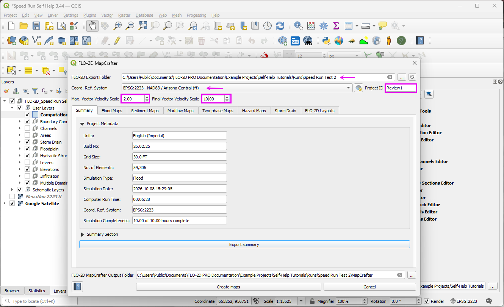
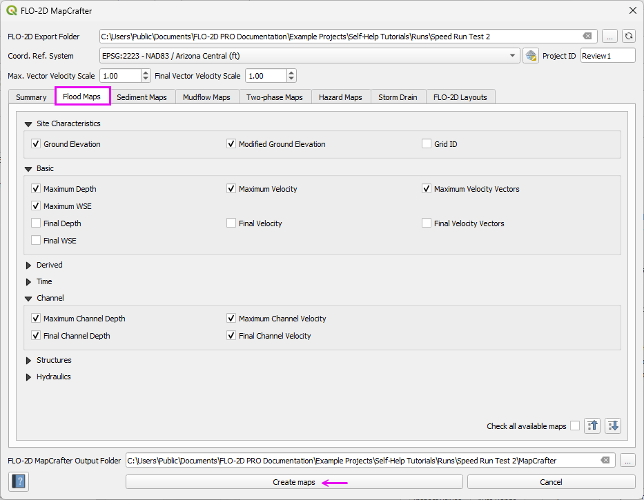
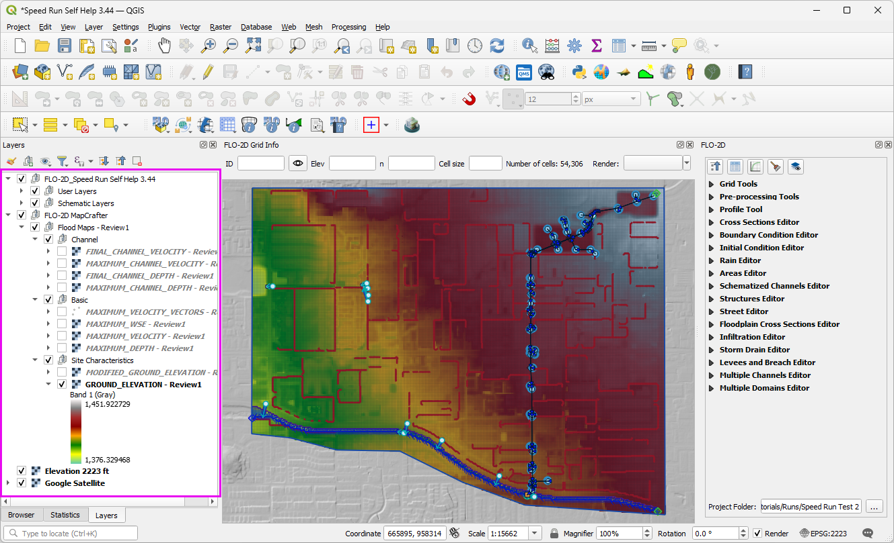
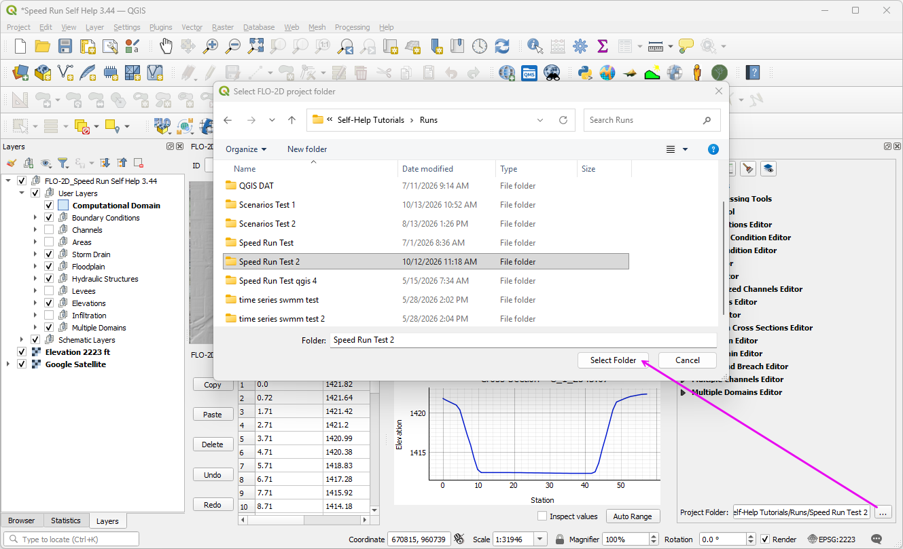

Project Review and Mapping
==========================

Load Results and Maps
---------------------

.. note:: Placeholder video. Final version not ready. This is currently under construction. 

.. raw:: html

   <iframe width="560" height="315" src="https://www.youtube.com/embed/ebIFoGUuQcI?si=XMiARpQIkzIPD5Es"
   title="YouTube video player" frameborder="0" allow="accelerometer; autoplay; clipboard-write; encrypted-media;
   gyroscope; picture-in-picture; web-share" referrerpolicy="strict-origin-when-cross-origin" allowfullscreen></iframe>

Load the maps and results to prepare for the project review.

Step 1: Run FLO-2D MapCrafter
~~~~~~~~~~~~~~~~~~~~~~~~~~~~~~

- Open FLO-2D MapCrafter.
- Select the completed model run folder and enter a project ID.
- Verify the coordinate reference system. 
- Review the MapCrafter simulation summary and completeness information.

- Open the Flood Maps options. Select the maps needed for the review, including:
    - Ground and Modified Ground Elevation
    - Basic Flood Maps
    - Channel Maps
- Click **Create Maps**. The generated maps are added to the QGIS Layers panel under the project ID.

.. note:: The modified ground elevation map reflects elevation adjustments made by the FLO-2D engine during the simulation, 
   such as adjustments at outflow elements, channel banks, or storm drain rims.

- Move the MapCrafter group to a convenient position in the Layers panel. 

Step 2: Set the Results Folder
~~~~~~~~~~~~~~~~~~~~~~~~~~~~~~

- In the FLO-2D panel, locate the results folder path.
- Click the **...** browse button and select the completed simulation run folder.
- The Results Tool can now access time-dependent output for grid elements and other modeled features. 
- Detailed results plots are covered in the next section.

Step 3: Import the Results Mesh
~~~~~~~~~~~~~~~~~~~~~~~~~~~~~~~

.. dropdown:: Troubleshooting: HDF5 Mesh Import with Channel Data

   If the FLO-2D model contains channels, the mesh import may fail because
   the ``Channel`` group in ``TIMDEP.HDF5`` has a different array size
   than the other datasets.

   To resolve this issue:

   #. Open **HDFView**.
   #. Open ``TIMDEP.HDF5`` in **Read/Write** mode.

   .. image:: ../img/shg/9/mrev009.png

   #. Expand the HDF5 hierarchy and locate the ``Channel`` group.
   #. Right-click the ``Channel Water Surface Elevation`` group and select **Delete**.

   .. image:: ../img/shg/9/mrev010.png

   #. Close the file.
   #. Return to QGIS and import the mesh.

   .. note::

      Make a backup of ``TIMDEP.HDF5`` before deleting the
      ``Channel`` group. This workaround removes the incompatible
      channel dataset without modifying the original simulation results
      stored elsewhere.

- Open the QGIS **Data Source Manager** and select the **Mesh Tab**.
- Browse to the completed run folder and select ``DEPTH.OUT`` as the mesh data source.
- Click **Add**. When the available mesh layers appear, select the **2D mesh** and click **Add Layers**. The 1D mesh is not needed for this exercise.
- Close the Data Source Manager and locate the new mesh layer in the QGIS Layers panel.

.. image:: ../img/shg/9/mrev004.png

.. image:: ../img/shg/9/mrev005.png

- The mesh initially displays bed elevation. Open the **Layer Styling** panel to select other results, such as depth, velocity, velocity vectors, or water surface elevation.

.. image:: ../img/shg/9/mrev007.png

- Select a time-dependent result. At simulation time zero, the displayed results may be empty; select maximum results to confirm that data are available.
- Open the QGIS **Temporal Controller**, activate temporal navigation, and set the animation range to the full available simulation period.
- Advance through the time steps to review how rainfall runoff develops and moves through the model domain.

.. note:: Mesh styling and detailed interpretation of time-dependent results are covered in later sections of the tutorial.

Review a Project Run
---------------------

.. note:: Placeholder video. Final version not ready.

.. raw:: html

   <iframe width="560" height="315" src="https://www.youtube.com/embed/ebIFoGUuQcI?si=XMiARpQIkzIPD5Es"
   title="YouTube video player" frameborder="0" allow="accelerometer; autoplay; clipboard-write; encrypted-media;
   gyroscope; picture-in-picture; web-share" referrerpolicy="strict-origin-when-cross-origin" allowfullscreen></iframe>

Use the FLO-2D results tools to examine hydraulic conditions at selected locations and evaluate model performance.

Step 1: Use the Results Tool
~~~~~~~~~~~~~~~~~~~~~~~~~~~~~~~~~

- Click the FLO-2D Results Tool button.
- Select a grid element to review the simulated hydraulic results.

.. image:: ../img/shg/9/mrev008.png

- Plot available time-dependent results, including flow depth, water surface elevation, and velocity.
- Examine hydrographs at selected locations to identify peak values and their timing.
- Review channel, hydraulic structure, and cross-section results where applicable.
- Compare results at different locations to understand how floodwater moves through the model domain.

Step 2: Profile Tool
~~~~~~~~~~~~~~~~~~~~~~~~~~

- Open the Profile Tool and select the appropriate profile or channel feature.
- Generate a longitudinal profile to examine ground elevations and simulated water surface elevations.
- Review changes in water surface elevation along the selected profile.
- Identify potential flow restrictions, backwater conditions, and abrupt changes in hydraulic grade.
- Examine channel profiles and hydraulic structure locations where applicable.

Review Scenarios
----------------

.. note:: Placeholder video. Final version not ready.

.. raw:: html

   <iframe width="560" height="315" src="https://www.youtube.com/embed/ebIFoGUuQcI?si=XMiARpQIkzIPD5Es"
   title="YouTube video player" frameborder="0" allow="accelerometer; autoplay; clipboard-write; encrypted-media;
   gyroscope; picture-in-picture; web-share" referrerpolicy="strict-origin-when-cross-origin" allowfullscreen></iframe>

Compare model scenarios to evaluate how changes in terrain, hydraulic structures, or other model parameters affect flooding.

Step 1: Compare Model Results
~~~~~~~~~~~~~~~~~~~~~~~~~~~~~~~~~~~~

- Load the results from the scenarios being evaluated.
- Confirm that the scenarios use compatible coordinate systems, grid geometry, and hydrologic conditions.
- Display the maximum depth, water surface elevation, and velocity maps for each scenario.
- Compare flood extents and identify areas where hydraulic conditions have changed.
- Evaluate changes in peak discharge, water surface elevation, and hydrograph timing at selected locations.
- Document significant differences between scenarios and identify locations requiring additional review.
