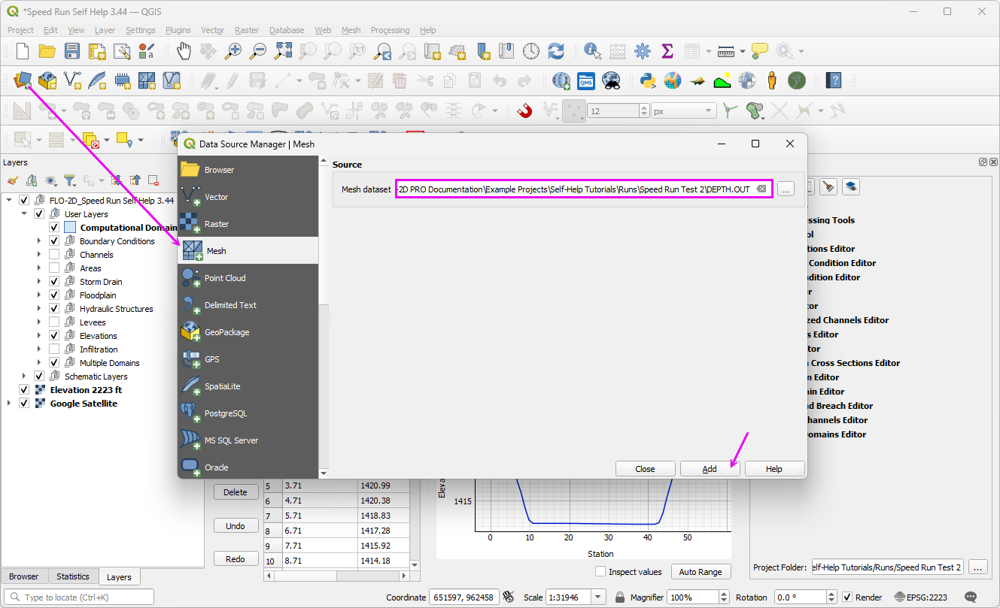
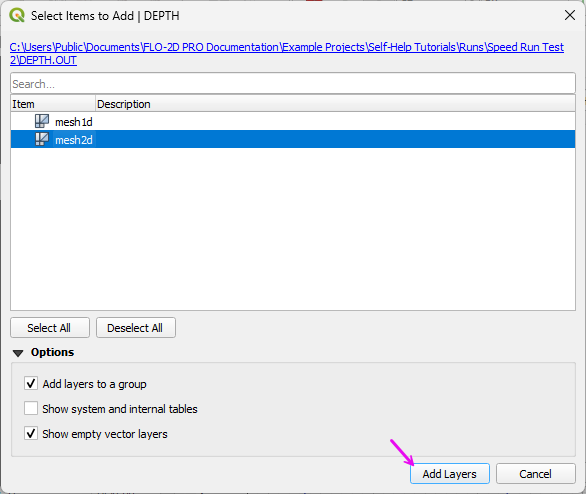
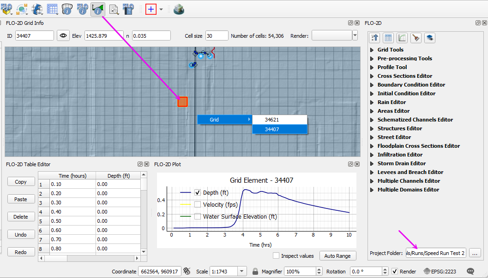

Project Review and Mapping
==========================

Load Results and Maps
---------------------

.. note:: Placeholder video. Final version not ready. This is currently under construction. 

.. raw:: html

   <iframe width="560" height="315" src="https://www.youtube.com/embed/ebIFoGUuQcI?si=XMiARpQIkzIPD5Es"
   title="YouTube video player" frameborder="0" allow="accelerometer; autoplay; clipboard-write; encrypted-media;
   gyroscope; picture-in-picture; web-share" referrerpolicy="strict-origin-when-cross-origin" allowfullscreen></iframe>

Load the maps and results to prepare for the project review.

.. Dropdown:: FLO-2D MapCrafter

   - Open FLO-2D MapCrafter.
   - Select the completed model run folder and enter a project ID.
   - Verify the coordinate reference system. 
   - Review the MapCrafter simulation summary and completeness information.

   .. image:: ../img/shg/9/mrev001.png

   - Open the Flood Maps options. Select the maps needed for the review, including:
      - Ground and Modified Ground Elevation
      - Basic Flood Maps
      - Channel Maps
   - Click **Create Maps**. The generated maps are added to the QGIS Layers panel under the project ID.

   .. note:: The modified ground elevation map reflects elevation adjustments made by the FLO-2D engine during the simulation, 
      such as adjustments at outflow elements, channel banks, or storm drain rims.

   .. image:: ../img/shg/9/mrev003.png

   - Move the MapCrafter group to a convenient position in the Layers panel. 

   .. image:: ../img/shg/9/mrev006.png

.. dropdown:: Set the Results Folder

   - In the FLO-2D panel, locate the results folder path.
   - Click the **...** browse button and select the completed simulation run folder.
   - The Results Tool can now access time-dependent output for grid elements and other modeled features. 
   - Detailed results plots are covered in the next section.

   .. image:: ../img/shg/9/mrev002.png

Mesh Mapping Tool
---------------------

.. dropdown:: Troubleshooting: HDF5 Mesh Import with Channel Data

   If the FLO-2D model contains channels, the mesh import may fail because
   the ``Channel`` dataset in ``TIMDEP.HDF5`` has a different array size
   than the other datasets.

   To resolve this issue:

   #. Open **HDFView**.
   #. Open ``TIMDEP.HDF5`` in **Read/Write** mode.

   .. image:: ../img/shg/9/mrev009.png

   #. Expand the HDF5 hierarchy and locate the ``Channel`` dataset.
   #. Right-click the ``Channel Water Surface Elevation`` group and select **Delete**.

   .. image:: ../img/shg/9/mrev010.png

   #. Close the file.
   #. Return to QGIS and import the mesh.

- Open the QGIS **Data Source Manager** and select the **Mesh Tab**.
- Browse to the completed run folder and select ``DEPTH.OUT`` as the mesh data source.
- Click **Add**. When the available mesh layers appear, select the **2D mesh** and click **Add Layers**. The 1D mesh is not needed for this exercise.
- Close the Data Source Manager and locate the new mesh layer in the QGIS Layers panel.

.. dropdown:: Troubleshooting: Where Is the Mesh Layer?

   Unlike FLO-2D imported layers, the mesh layer is not automatically
   added to the top of the QGIS Layers panel. It may be difficult to
   locate in projects containing many layers.

   To locate the mesh layer:

   #. Open the QGIS **Locator Bar**.
   #. Search for ``Mesh`` to filter the available layers.
   #. Select the mesh layer from the search results to locate it
      in the Layers panel.
   #. This is a good time to position the ``Mesh`` layer below the project layers
      and above the elevation and aerial layers.

   .. image:: ../img/shg/9/mrev011.png

.. dropdown:: Mesh Display Options

   The mesh layer initially displays the **Bed Elevation** dataset.
   Use the QGIS **Layer Styling** panel to display and customize
   FLO-2D simulation results.

   **Task 1: Open the Layer Styling Panel**

   #. Select the mesh layer in the QGIS Layers panel.
   #. Open the **Layer Styling** panel.
   #. Dock the **Layer Styling** panel with the **FLO-2D** panel.
   #. Expand the panel until the result visibility icons are displayed.

   **Task 2: Select and Display Results**

   #. Locate the available result datasets in the **Layer Styling** panel.
   #. Select a scalar result, such as depth, velocity magnitude, or
      water surface elevation.
   #. Click the **Color** icon to show or hide the scalar results.
   #. Click the **Arrow** icon to show or hide velocity vectors.
   #. Select **Maximum** results to display peak simulation conditions,
      or **Time** results to display values at individual time steps.

   **Task 3: Style Scalar Results**

   #. Select the desired scalar result dataset.
   #. Open the **Style** tab.
   #. Select a color ramp to represent the result values.
   #. Adjust the classification ranges and minimum and maximum values
      as needed.

   **Task 4: Style Velocity Vectors**

   #. Enable the velocity vectors using the **Arrow** icon.
   #. Open the **Vector Style** tab.
   #. Adjust the arrow size, scaling, and appearance to improve
      visualization of flow direction and magnitude.

   **Task 5: Review Mesh Display Options**

   #. Switch between **Maximum** and **Time** results to compare
      peak conditions with time-dependent simulation results.
   #. Enable or disable mesh edges to display the computational grid.
   #. Use the QGIS **Temporal Controller** to advance through the
      simulation and review changes in flow conditions.

.. dropdown:: Mesh Temporal Control Options

   The QGIS **Temporal Controller** allows users to visualize
   time-dependent FLO-2D simulation results and animate changes
   in flow depth, velocity, and water surface elevation.

   **Task 1: Select Time-Dependent Results**

   #. Select the mesh layer in the QGIS Layers panel.
   #. Open the **Layer Styling** panel.
   #. Select a time-dependent result, such as flow depth, velocity
      magnitude, or water surface elevation.
   #. If the results are not visible at simulation time zero,
      select **Maximum** results to confirm that data are available.

   **Task 2: Configure the Temporal Controller**

   #. Open the QGIS **Temporal Controller** panel.
   #. Select **Animated Temporal Navigation** to enable animation controls.
   #. Set the animation range to the full available simulation period.
   #. Configure the time step interval to match the available
      FLO-2D results.

   **Task 3: Review Time-Dependent Results**

   #. Use the **Next Frame** and **Previous Frame** controls to
      advance through individual time steps.
   #. Click **Play** to animate the simulation results.
   #. Observe how rainfall runoff develops and moves through
      the model domain.
   #. Pause the animation at any time to examine flow conditions
      at a specific simulation time.

   **Task 4: Adjust Animation Settings**

   #. Adjust the animation speed using the **Frames per Second**
      setting.
   #. Change the temporal range to focus on a specific portion
      of the simulation.
   #. Switch between depth, velocity, and water surface elevation
      results to compare hydraulic conditions over time.

   .. note::

      **Changing the Temporal Controller from Hours to Minutes**

      To display the animation time steps in minutes instead of hours,
      open the **Temporal Controller** settings and change the
      **Step Unit** from **Hours** to **Minutes**. Adjust the
      **Step** value as needed to match the desired animation interval.

Review a Project Run
---------------------

.. note:: Placeholder video. Final version not ready.

.. raw:: html

   <iframe width="560" height="315" src="https://www.youtube.com/embed/ebIFoGUuQcI?si=XMiARpQIkzIPD5Es"
   title="YouTube video player" frameborder="0" allow="accelerometer; autoplay; clipboard-write; encrypted-media;
   gyroscope; picture-in-picture; web-share" referrerpolicy="strict-origin-when-cross-origin" allowfullscreen></iframe>

Use the FLO-2D results tools to examine hydraulic conditions at selected locations and evaluate model performance.

Step 1: Use the Results Tool
~~~~~~~~~~~~~~~~~~~~~~~~~~~~~~~~~

- Click the FLO-2D Results Tool button.
- Select a grid element to review the simulated hydraulic results.

- Plot available time-dependent results, including flow depth, water surface elevation, and velocity.
- Examine hydrographs at selected locations to identify peak values and their timing.
- Review channel, hydraulic structure, and cross-section results where applicable.
- Compare results at different locations to understand how floodwater moves through the model domain.

Step 2: Profile Tool
~~~~~~~~~~~~~~~~~~~~~~~~~~

- Open the Profile Tool and select the appropriate profile or channel feature.
- Generate a longitudinal profile to examine ground elevations and simulated water surface elevations.
- Review changes in water surface elevation along the selected profile.
- Identify potential flow restrictions, backwater conditions, and abrupt changes in hydraulic grade.
- Examine channel profiles and hydraulic structure locations where applicable.

Review Scenarios
----------------

.. note:: Placeholder video. Final version not ready.

.. raw:: html

   <iframe width="560" height="315" src="https://www.youtube.com/embed/ebIFoGUuQcI?si=XMiARpQIkzIPD5Es"
   title="YouTube video player" frameborder="0" allow="accelerometer; autoplay; clipboard-write; encrypted-media;
   gyroscope; picture-in-picture; web-share" referrerpolicy="strict-origin-when-cross-origin" allowfullscreen></iframe>

Compare model scenarios to evaluate how changes in terrain, hydraulic structures, or other model parameters affect flooding.

Step 1: Compare Model Results
~~~~~~~~~~~~~~~~~~~~~~~~~~~~~~~~~~~~

- Load the results from the scenarios being evaluated.
- Confirm that the scenarios use compatible coordinate systems, grid geometry, and hydrologic conditions.
- Display the maximum depth, water surface elevation, and velocity maps for each scenario.
- Compare flood extents and identify areas where hydraulic conditions have changed.
- Evaluate changes in peak discharge, water surface elevation, and hydrograph timing at selected locations.
- Document significant differences between scenarios and identify locations requiring additional review.
